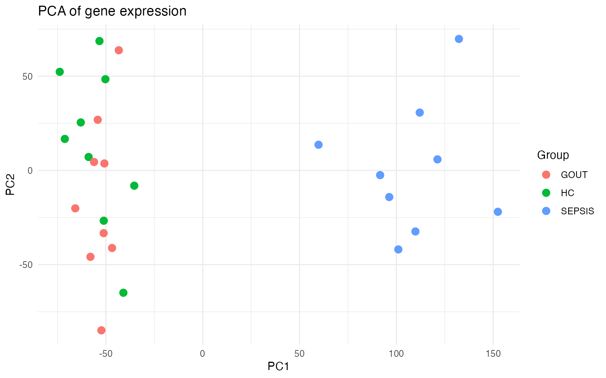
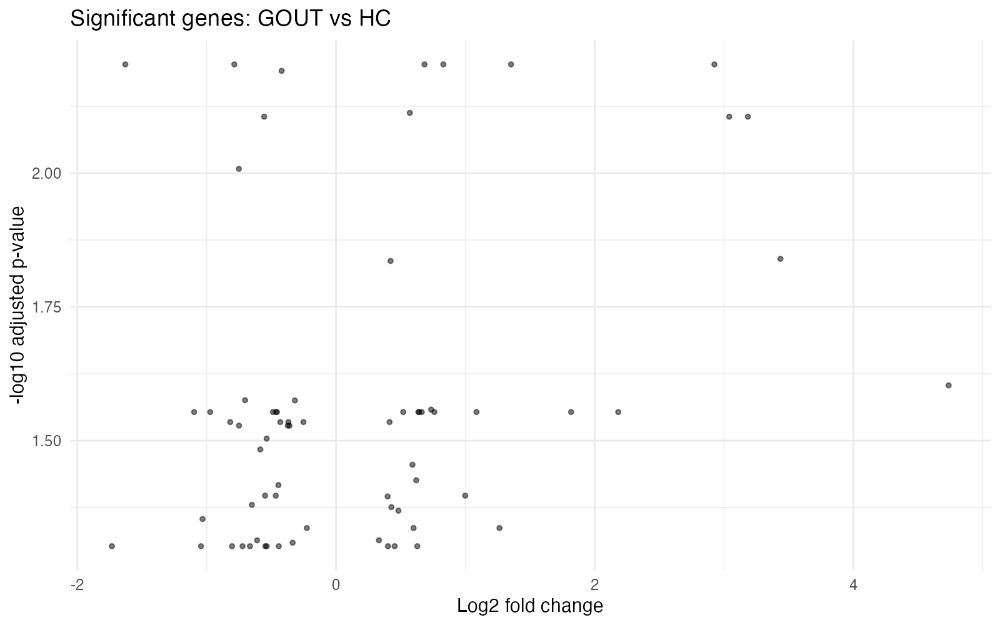
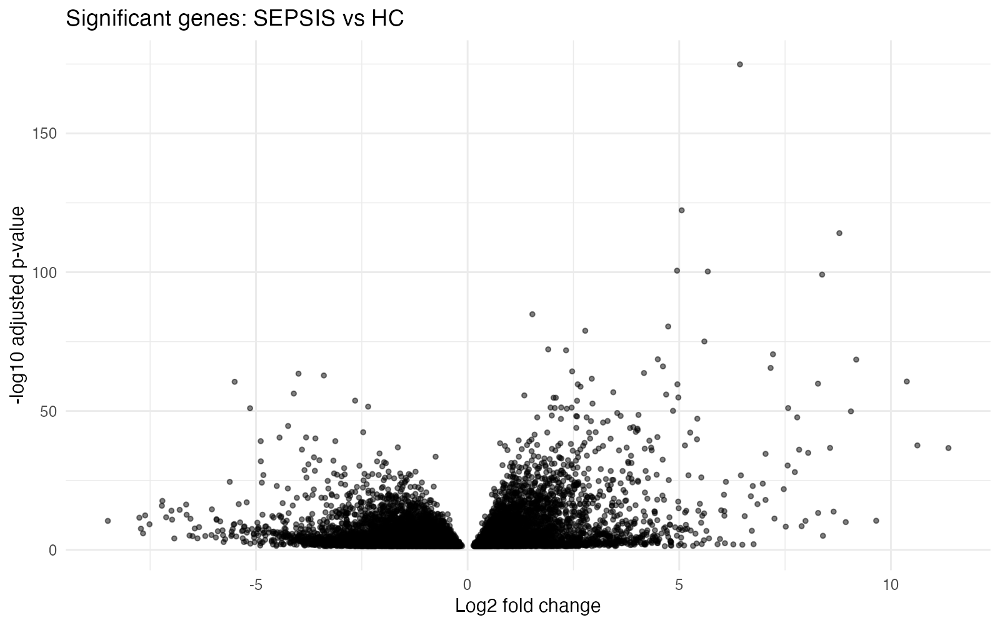
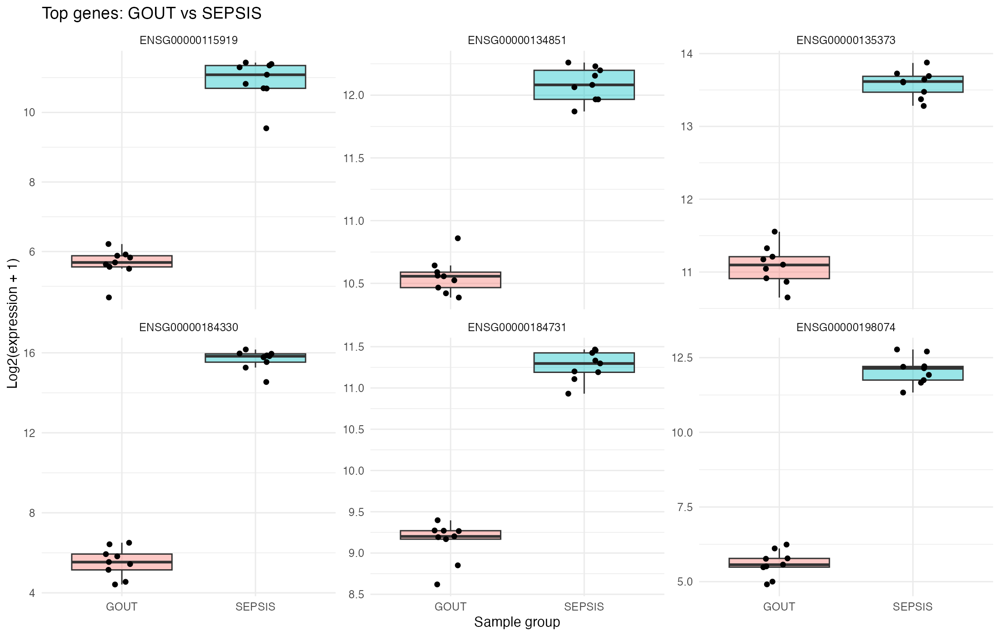

# Statistical Analysis of Gout and Septic Arthritis Gene Expression

An exploratory statistical analysis of clinical and RNA-seq gene expression data using R, investigating differences between gout, septic arthritis (SA), and healthy controls (HC).

Originally developed for the Statistics and Data Analysis for Bioinformatics coursework at the University of Glasgow, and subsequently revised to improve reproducibility and statistical reporting.

## Research Question

Gout and septic arthritis can present with similar clinical symptoms, making them difficult to distinguish.

This project explores whether their similarities extend to gene expression patterns in whole blood, and whether statistical analysis can identify differences between the two conditions.

## Dataset

The analysis uses supplied RNA-seq expression data, clinical information, gene annotations, and differential expression results.

Three sample groups were analysed:

- Healthy controls (HC): 9 samples
- Gout (GOUT): 9 samples
- Septic arthritis (SEPSIS): 9 samples

The expression table contains measurements for 29,814 genes across 27 samples.

The assignment brief describes 14 samples per group, but the actual supplied files used in this analysis contain 9 per group.

The original SEPSIS label is retained in the code.

## Methods

### Clinical Data Analysis

- Descriptive statistics for sex and neutrophil counts
- Fisher's exact test for sex distribution
- One-way ANOVA for neutrophil counts

### Gene Expression Analysis

- Principal Component Analysis (PCA) of log2-transformed expression
- Exploration of supplied differential expression results for GOUT vs HC and SEPSIS vs HC
- Identification and visualisation of top-ranked genes
- Welch's t-tests investigating associations with sex
- Pearson correlations with neutrophil counts
- Exploratory gene-wise Welch's t-tests comparing GOUT and SEPSIS
- Benjamini-Hochberg correction for multiple testing

## Key Findings

- Neutrophil counts differed significantly between groups in the original ANOVA analysis (p = 3.25e-05).
- Fisher's exact test for sex distribution returned p = 1.0.
- In the revised exploratory GOUT vs SEPSIS comparison, 11,041 genes met the BH-adjusted p-value threshold of 0.05.

The GOUT vs SEPSIS analysis used log2(expression + 1) values.

These results are exploratory and do not establish validated disease biomarkers or diagnostic performance.

## Visualisations

### Principal Component Analysis

### Gout vs Healthy Controls

### Septic Arthritis vs Healthy Controls

### Selected Gout vs Septic Arthritis Genes

## Repository Structure

- scripts/clinical_gene_expression_analysis.R - R analysis script
- results/ - Selected figures
- README.md - Project documentation

## Requirements

- R
- ggplot2
- tibble

Install the R packages using:

    install.packages(c("ggplot2", "tibble"))

## Running the Analysis

The analysis requires the following supplied input files:

- Sample_Information.csv
- Expression_Table.csv
- DE_GOUT_vs_HC.csv
- DE_SA_vs_HC.csv
- Annotations.csv

Place these files in a local directory and run from the repository root:

    DATA_DIR="/path/to/data" Rscript scripts/clinical_gene_expression_analysis.R

Selected figures are saved in the results/ directory.

The original datasets are not included in this repository.

## Limitations

- Small sample size of nine per group
- The original expression normalisation method has not been independently verified
- Gene-wise Welch's t-tests are exploratory and do not replace a dedicated RNA-seq differential expression analysis
- No independent validation cohort
- Statistical significance alone does not establish diagnostic utility

## Project Notes

This repository contains a revised version of the original coursework analysis.

The revisions address coding errors, improve statistical reporting, apply multiple-testing correction, and update the visualisations.

The revised exploratory results differ from the conclusions in the originally submitted coursework report.
